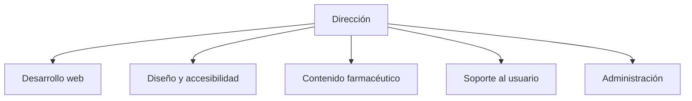

# 01 · Análisis y documentación inicial (RA1)

> **Plantilla.** Se entrega como **H1 el 26-nov-2026**. Cada apartado indica el criterio de evaluación (CE) que evidencia y qué se espera. Borra las notas en cursiva al rellenar.

## 1. Sector y empresas (CE 1a, 1b)

Sector: farmacéutico y de información sanitaria al ciudadano, con la gestión de residuos de medicamentos como actividad relacionada.

| Empresa / entidad | Tipo (organización) | Producto o servicio |
|---|---|---|
| Cinfa | Laboratorio fabricante | Medicamentos genéricos y de marca |
| Laboratorios Normon | Laboratorio fabricante | Medicamentos genéricos |
| Cofares | Distribuidor farmacéutico (cooperativa) | Distribución de medicamentos a farmacias |
| Hefame | Distribuidor farmacéutico (cooperativa) | Distribución de medicamentos a farmacias |
| SIGRE | Sistema colectivo de gestión de residuos de envases | Recogida y reciclaje de envases y restos de medicamentos en farmacias |
| Vademecum.es | Web informativa | Fichas y prospectos de medicamentos |
| Farmacia comunitaria | Pequeño comercio sanitario | Dispensación y consejo al ciudadano |

**Empresa tipo: pyme que desarrolla y mantiene Farmaweb.**

- **Dirección:** define la estrategia, gestiona el presupuesto y responde legalmente del servicio.
- **Desarrollo web:** programa y despliega la web, mantiene la base de datos y garantiza la seguridad.
- **Diseño y accesibilidad:** diseña interfaces sencillas para personas mayores y comprueba la accesibilidad.
- **Contenido farmacéutico:** recopila y revisa fichas, categorías e imágenes con apoyo de un farmacéutico.
- **Soporte al usuario:** atiende dudas e incidencias.
- **Administración:** gestiona facturas, impuestos y contratos.

## 2. Necesidades y oportunidades (CE 1c, 1d)

*Lista **priorizada** de las necesidades más demandadas, con el criterio de priorización y la fuente. Valora las oportunidades de negocio con **al menos un dato cuantitativo** y su fuente.*

1. **Identificar con seguridad un medicamento sin prospecto.** Riesgo sanitario más alto. Fuente: observación propia [REVISAR: añade tu caso o el de tu familia]. El Ministerio para la Transición Ecológica indica que los medicamentos deben entregarse en su caja y con su prospecto para poder identificarlos (miteco.gob.es, "¿Cuál es su ciclo de gestión?").
2. **Saber cuándo un medicamento ya no conviene tomarlo.** Afecta a cualquier hogar con botiquín.
3. **Saber dónde y cómo desechar los medicamentos viejos.** Afecta a la mayoría de hogares.
4. **Acceder al prospecto de forma cómoda.** Ayuda a quien tiene dificultad para buscarlo.

**Oportunidad de negocio (dato cuantitativo):** en 2025 se recogieron 5.397.903 kg de envases y restos de medicamentos en los Puntos SIGRE (+5,16 % respecto a 2024), con 22.280 farmacias colaboradoras y tres de cada cuatro hogares españoles participando. Fuente: SIGRE, nota de Europa Press publicada en Infosalus el 22-sep-2026. Esto indica un hábito consolidado que Farmaweb puede reforzar con información clara.

## 3. Tipo de proyecto elegido (CE 1e)

Aplicación web responsive (también en móvil, sin instalar nada), de contenido informativo y muy visual.

Alternativas descartadas:
- **App nativa:** exige instalación y tiendas de aplicaciones, lo que supone una barrera para personas mayores.
- **Reconocimiento automático por foto con IA:** técnicamente muy complejo y con riesgo si se equivoca. Queda como mejora futura.
- **Documento o PDF estático:** no permite buscar ni navegar por categorías.

## 4. Requisitos y restricciones (CE 1f)

*Características que debe cumplir el proyecto, redactadas de forma **verificable** (no «debe ser rápido», sino «responde en menos de 2 s»). Parte de lo que has encontrado en [`01b-sota.md`](01b-sota.md).*

> **Guía.** Numera los requisitos **funcionales** como **RF-01, RF-02…** (qué hace el sistema) y los **no funcionales** como **RNF-01…** (cómo lo hace: rendimiento, seguridad, usabilidad, disponibilidad, accesibilidad). Las **restricciones** (plazo, presupuesto, tecnología obligatoria, normativa) como **REST-01…**. Cada requisito debe tener **una medida o una prueba**. Si aún no sabes cómo lo probarás, escribe «pendiente» y complétalo antes de H3.

| ID | Requisito | Tipo | Cómo se verifica |
|---|---|---|---|
| RF-01 | El usuario llega a la ficha de un medicamento navegando por categorías de utilidad en 3 clics o menos desde la portada | funcional | Prueba manual contando clics con 5 medicamentos |
| RF-02 | Cada ficha muestra foto, para qué sirve y un aviso visible sobre su uso pasado el tiempo | funcional | Revisión de todas las fichas |
| RF-03 | El buscador por nombre devuelve el medicamento con su imagen | funcional | Prueba con 10 nombres de medicamentos |
| RF-04 | Existe una sección que explica dónde desechar medicamentos viejos | funcional | Comprobación de que es accesible desde el menú |
| RF-05 | Existe una sección con los prospectos en PDF | funcional | Comprobación de que los enlaces abren el PDF |
| RNF-01 | La portada carga en menos de 3 s en móvil | no funcional | Lighthouse (pendiente) |
| RNF-02 | Letra base de 18 px o más y contraste mínimo 4,5:1 | no funcional | Lighthouse y comprobador de contraste |
| RNF-03 | La web se ve sin scroll horizontal desde 360 px de ancho | no funcional | Prueba en modo responsive del navegador |
| RNF-04 | Al menos 3 personas mayores de 65 años encuentran un medicamento sin ayuda en menos de 2 minutos | no funcional | Prueba con usuarios (pendiente) |
| RNF-05 | Todas las fichas incluyen el aviso de que la web no sustituye al médico ni al farmacéutico | no funcional | Revisión de todas las fichas |
| REST-01 | Primera versión mínima funcionando antes del 31-mar | restricción | Entrega y demostración |
| REST-02 | Presupuesto 0 €: solo herramientas gratuitas | restricción | Revisión de herramientas |
| REST-03 | Solo datos públicos y de ejemplo, sin datos personales reales | restricción | Revisión de la base de datos |
| REST-04 | Usar tecnologías vistas en los módulos de 2.º | restricción | Memoria final |

### Matriz de trazabilidad

| Objetivo | Requisito | Caso de uso | Pantalla o endpoint | Prueba o indicador |
|---|---|---|---|---|
| OBJ-01 Identificar un medicamento visualmente | RF-01, RF-02, RF-03 | | | pendiente |
| OBJ-02 Desechar bien los medicamentos | RF-04 | | | pendiente |
| OBJ-03 Que lo use cualquier persona mayor | RNF-02, RNF-03, RNF-04 | | | pendiente |

## 5. Obligaciones fiscales, laborales y de prevención (CE 1g)
### Matriz de trazabilidad

*Une cada objetivo con sus requisitos, y estos con lo que los implementa y los comprueba. Se rellena por completo al final del proyecto; en H1 basta con **objetivo y requisito**.*

> **Guía.** Ejemplo ficticio: *OBJ-01 Gestionar citas → RF-02 Crear una cita → CU-03 → `POST /citas` → prueba P-07.* Cada RF y cada RNF de la tabla anterior debe aparecer aquí.

| Objetivo | Requisito | Caso de uso | Pantalla o endpoint | Prueba o indicador |
|---|---|---|---|---|
| OBJ-01 [RELLENAR] | RF-01 | | | pendiente |

## 5. Obligaciones fiscales, laborales y de prevención (CE 1g)

- **Fiscal:** alta en el censo de empresarios (Agencia Tributaria), IVA (Ley 37/1992) e IRPF (Ley 35/2006). Si fuera autónoma, cotización al RETA (Ley General de la Seguridad Social, RDL 8/2015).
- **Laboral:** si hubiera empleados, Estatuto de los Trabajadores (RDL 2/2015) y alta en la Seguridad Social.
- **Prevención de riesgos:** Ley 31/1995 de Prevención de Riesgos Laborales y RD 488/1997 sobre trabajo con pantallas de visualización.
- **Protección de datos:** RGPD (UE 2016/679) y LOPDGDD (LO 3/2018). Farmaweb no guarda datos personales, pero si añade analítica o cookies deberá informarlo.
- **Servicios web:** Ley 34/2002 (LSSI-CE): aviso legal e identificación del titular.
- **Accesibilidad:** Ley 11/2023 de accesibilidad de ciertos productos y servicios, que transpone la Directiva (UE) 2019/882. Comprobar si afecta a una microempresa.
- **Medicamentos:** la web informa, no vende ni hace publicidad. Revisar el texto refundido de la Ley de garantías y uso racional de los medicamentos (RDL 1/2015).

## 6. Ayudas y subvenciones (CE 1h)

Convocatorias del Principado de Asturias de 2026, hoy cerradas. Sirven de referencia para la siguiente convocatoria:

1. **Subvenciones a la competitividad, innovación y digitalización de pymes comerciales.** Resolución de 1-jul-2026, Consejería de Ciencia, Industria y Empleo (BOPA núm. 133, 13-jul-2026). Subvenciona hasta el 50 % de la inversión. Requisito: actividad en establecimiento comercial con domicilio social y fiscal en Asturias. Plazo 2026: del 14-jul al 14-ago-2026.
2. **Ayudas para el impulso empresarial de autónomos, microempresas, pymes.** Resolución de 17-abr-2026 (BOPA núm. 103, 1-jun-2026). Según la prensa (Merca2), hasta el 50 % con un máximo de 10.000 € por negocio. Plazo 2026: hasta el 12-jun-2026.

## 7. Guion de trabajo (CE 1i)

Proyecto individual: responsable, Maaia.

| Fase | Contenido | Fecha |
|---|---|---|
| 1. Análisis | Este documento y el estado del arte (01b-sota.md) | hasta 26-nov-2026 |
| 2. Diseño | Árbol de categorías y prototipo en Figma | [REVISAR] |
| 3. Datos y servidor | Base de datos de medicamentos y consultas | [REVISAR] |
| 4. Interfaz | Páginas visuales, buscador y secciones | [REVISAR] |
| 5. Pruebas y despliegue | Pruebas con usuarios, accesibilidad y publicación | [REVISAR] |
| Hito | Primera versión mínima funcionando | antes del 31-mar |

## 8. Glosario

*Una cosa, un nombre: define los términos del dominio y de tu proyecto, y anota los sinónimos que **no** vas a usar en ningún documento. Con **5 términos** basta; crece con el proyecto.*

| Término | Definición | Sinónimos que NO uso |
|---|---|---|
| Medicamento | Producto farmacéutico con un uso concreto | pastilla, droga, medicina |
| Ficha | Página de un medicamento con su foto y su información | tarjeta, entrada |
| Categoría | Grupo de medicamentos por utilidad (dolor de cabeza, resfriado...) | tipo, familia |
| Punto SIGRE | Contenedor de la farmacia donde se depositan medicamentos viejos | contenedor, papelera |
| Prospecto | Documento informativo que acompaña al medicamento | folleto, instrucciones |
---

## Criterios de evaluación de este documento (RA1, texto literal)

- **1a)** Se han clasificado las empresas del sector por sus características organizativas y el tipo de producto o servicio que ofrecen.
- **1b)** Se han caracterizado las empresas tipo indicando la estructura organizativa y las funciones de cada departamento.
- **1c)** Se han identificado las necesidades más demandadas a las empresas.
- **1d)** Se han valorado las oportunidades de negocio previsibles en el sector.
- **1e)** Se ha identificado el tipo de proyecto requerido para dar respuesta a las demandas previstas.
- **1f)** Se han determinado las características específicas requeridas al proyecto.
- **1g)** Se han determinado las obligaciones fiscales, laborales y de prevención de riesgos y sus condiciones de aplicación.
- **1h)** Se han identificado posibles ayudas o subvenciones para la incorporación de nuevas tecnologías de producción o de servicio que se proponen.
- **1i)** Se ha elaborado el guión de trabajo que se va a seguir para la elaboración del proyecto.
